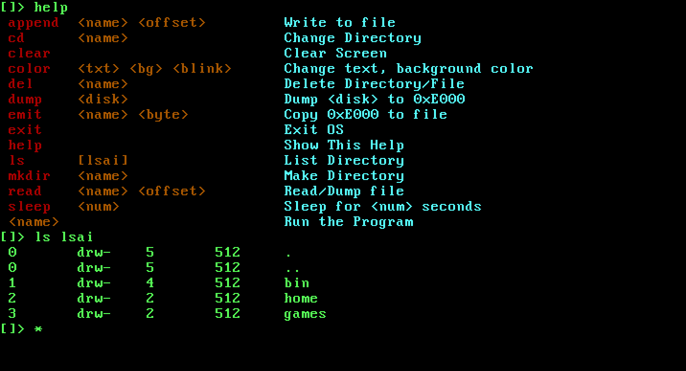
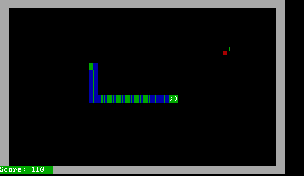
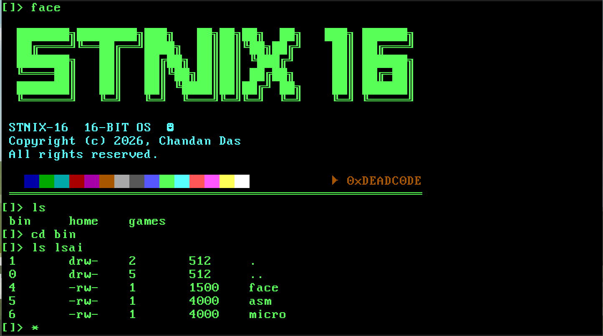
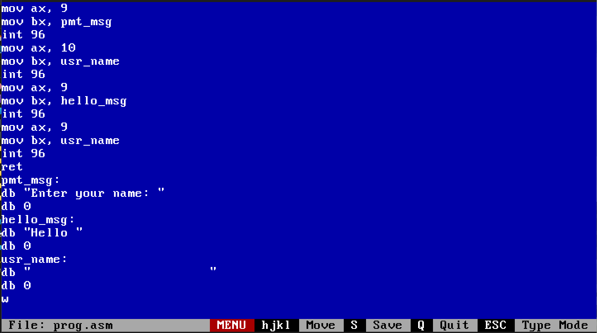
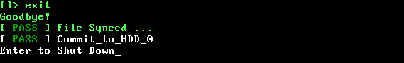
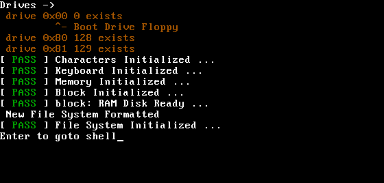
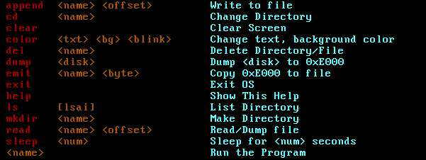

# STNIX 16

STNIX16 - a 16-bit, operating system for x86 (real mode). The kernel is **monolithic** with with custom Inode-based file system.
- Written in `C` and `Assembly`
- [`smlrc`](https://github.com/alexfru/smallerC) (Smaller C compiler by Alexey Frunze), used to compile the kernel and user programs to 16-bit real-mode code (`-seg16`)

| | |
|---|---|
|  |  |
|  |  |

## Features

- IO driver (Interrupt-driven keyboard, VGA console)
- Disk driver with a **RAM disk** (changes are committed automatically on exit)
- Memory Management (flat model)
- File System (Custom **Inode-based file system**)
- Process Management (Single-task process management)
- **29 distinct System Calls** for user (via `int 0x60`)
- **Custom C API** for writing user programs
- **Auto-installs** itself to the primary hard disk on exit

Built-in `shell`, an assembler (`asm`) and a text editor (`micro`) that run inside the OS

## Requirements

- `smlrc` (cross-compiler)
- `nasm`
- `make`
- `qemu-system-i386` (for testing)

To install everything:

```bash
./setup_require.sh
```

## Building and Running

**First run**: builds `os.img` and boots it in QEMU:

```bash
make run
```
Then do `exit`



When you `exit` the OS, it installs itself onto the primary disk (here`disk.hdd`). Use `make run` whenever you want to boot a freshly built OS.

**Subsequent runs**: boot directly from primary disk (as it is installed):

```bash
make run_hdd
```

Changes are saved in `disk.hdd`, so your files persist between runs.

Make Target 
- `make             ` : Build `os.img`
- `make run         ` : Boot the freshly built `os.img` in QEMU
- `make run_hdd     ` : Boot from `disk.hdd` (keeps files persist)
- `make run_term    ` : Like `run`, but in the terminal (curses display)
- `make run_hdd_term` : Like `run_hdd`, but in the terminal (curses display)
- `make clean       ` : to Remove build artifacts |

## Usage

On boot you should see something like:




Drive **128** is the boot drive (`disk.hdd`). Drive **129** is the connected program disk (`user/prog.hdd`), used for installing programs and exporting files.

### Built-in commands



Most of the commands are self-explanatory.

### Creating a file

```
[]> emit a.txt                  ; create a.txt with size 0
emit : 'a.txt' success
[]> append a.txt                ; write to a.txt from offset 0
> Hello
> Nice to Meet you
> +++                           ; type +++ to save the file
append : 'a.txt' success
[]> read a.txt                  ; read a.txt from offset 0
Hello
Nice to Meet you
[]> ls lsa
 drw-    5       512     .
 drw-    5       512     ..
 drw-    2       512     bin
 drw-    2       512     home
 drw-    2       512     games
 -rw-    1       23      a.txt
```
**Note**: Maximum file size is `8192 bytes or 8 KB`

## Running User Programs

Programs must be installed one by one before you can run them. Four programs are included in `.user/progs/`:

| Program | Description |
|---|---|
| `snake` | Snake game |
| `micro` | Text editor |
| `asm  ` | Assembler for a small subset of 8086 with NASM-like syntax |
| `face ` | similar to facefetch or noefetch |

### Example: installing Snake

1. Open `user/Makefile` and set the program to install in `C_SRC` (e.g. `progs/snake/main.c`).
```
C_SRC   = $(LIBAPIO) lib/prog_start.c \
			\
			progs/snake/main.c  <-- Here probably in line 21
```
2. Build the program disk and boot the OS:

   ```bash
   cd user
   make
   cd ..
   make run_hdd
   ```

3. Inside the OS:

   ```
   []> cd games
   []> dump 129                ; copy contents of disk 129 (user/prog.hdd) to the dump location
   []> emit snake 2500         ; create file 'snake' of 2500 bytes from the dump location
   emit : 'snake' success
   []> ls
    snake
   []> snake                   ; play!
   ```

   Make sure the size you give to `emit` (2500 here) larger than `prog.bin`.

Install the other programs the same way `progs/<prog_name>/main.c`  <-- change <prog_name> in `Makefile` line 21. Put them under `/bin` of OS so they can be run from any directory.

## Writing Assembly (in the OS)

Once `asm` and `micro` are installed, you can write assembly in the editor and assemble it inside the OS. The assembler supports a small subset of the 8086 instruction set with NASM-like syntax, and integers only.

System calls use `int 96` (`int 0x60`). For example:

```nasm
mov ax, 9
mov bx, pmt_msg
int 96
mov ax, 10
mov bx, usr_name
int 96
mov ax, 9
mov bx, hello_msg
int 96
mov ax, 9
mov bx, usr_name
int 96
ret
pmt_msg:
db "Enter your name: "
db 0
hello_msg:
db "Hello "
db 0
usr_name:
db "                    "
db 0
```

You can also write the program outside the OS and place it on `user/prog.hdd`, then copy it in:

```
[]> dump 129
[]> emit prog.asm 1500      ; change size as you want.
```

## Writing C Programs

STNIX 16 ships with its own C API. To write a program:

1. Create `user/progs/app_name/main.c`.
2. Edit `user/Makefile` and set the program to install (e.g. `progs/app_name/main.c`).
3. Build and install it as shown in [Running User Programs](#running-user-programs).

A sample program lives in `user/progs/TEST/main.c` (already referenced by `user/Makefile`). See `user/include/APIO.h` and `user/include/syscall.h` to learn how the API works.


## Acknowledgement

- [Smaller C (`smlrc`)](https://github.com/alexfru/smallerC) by Alexey Frunze, the C compiler used for the kernel and user programs


## License

This project is licensed under the [BSD 2-Clause License](LICENSE).
